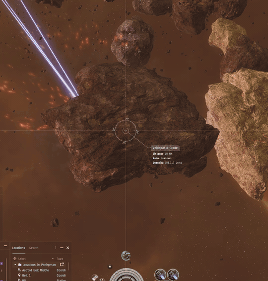

# Asteroid Erosion

Ore asteroids shrink as you mine them, shedding dust that scales with the rock.
At depletion, lingering dust covers the final remnant as it shrinks away,
replacing the burning dissolve effect.

**Version 0.1.6 · EveJS 0.12.9 · Native**

[Download the Launcher ZIP](https://github.com/V0nCleef/EveJS-Asteroid-Erosion/releases/download/v0.1.6/AsteroidErosion-0.1.6.zip) · [Release and demo video](https://github.com/V0nCleef/EveJS-Asteroid-Erosion/releases/tag/v0.1.6)

## Gameplay demo

[](https://github.com/V0nCleef/EveJS-Asteroid-Erosion/releases/download/v0.1.6/AsteroidErosion-0.1.6-demo.mp4)

An animated excerpt from V0nCleef's gameplay recording.
[Watch/download the original 18.7-second MP4](https://github.com/V0nCleef/EveJS-Asteroid-Erosion/releases/download/v0.1.6/AsteroidErosion-0.1.6-demo.mp4).

## Features

- Asteroid radius follows the remaining ore volume, including mining waste.
- Smooth shrinking is visible to nearby players.
- Dust follows the rendered rock's size and center.
- Twelve overlapping surface regions vary the puff shape, density and drift.
- Dust lingers briefly after the final remnant disappears.
- Existing native ore persistence supplies the saved size.

## Install with EveJS Launcher

1. Download **AsteroidErosion-0.1.6.zip** from the [release](https://github.com/V0nCleef/EveJS-Asteroid-Erosion/releases/tag/v0.1.6). Keep it zipped.
2. Close EVE clients and stop the Game server before installing or updating.
3. Open **Mods → Add ZIP**, select the ZIP, and enable **Asteroid Erosion**.
4. Start the **Game server**, fully reopen each EVE client, and log in.

The visual companion is delivered during login. Already-connected clients need
to be fully restarted to receive it.

To remove it, stop the clients and server, disable/remove the mod in the Launcher,
then start the server and clients again.

## Standalone Native server

Place the release ZIP contents under `<EveJS root>/mods/AsteroidErosion` and preload
the loader before the server:

```powershell
node --require ./mods/AsteroidErosion/loader.js ./server/index.js
```

## Settings

Edit `config.json` in the installed mod folder while the server and clients are
stopped. Restart them after changing settings.

| Setting | Default | Purpose |
| --- | --- | --- |
| `radiusExponent` | `1/3` | Volume-consistent radius; `0.5` exaggerates shrinking. |
| `minimumRadiusRatio` | `0.005` | Minimum radius as a fraction of the original. |
| `minimumRadiusMeters` | `2` | Minimum server radius, capped at the original radius. |
| `resizeDurationMs` | `600` | Ease each visible resize over this duration. |
| `depletionDurationMs` | `650` | Duration of the final visual shrink. |
| `dustEnabled` | `true` | Enable surface dust. |
| `dustIntensity` | `1` | Emission multiplier, from `0` to `3`. |
| `dustLifetimeMs` | `1400` | Particle lifetime, from `300` to `4000` ms. |
| `dustMaxConcurrent` | `24` | Maximum simultaneous dusty rocks, from `1` to `64`. |

Each active rock has one emitter with a maximum of 384 particles. Grid departure
and disconnect remove the owned effects.

## Compatibility and gameplay

- Supports the reviewed **EveJS 0.12.9 Native** source and client build **3396210**.
- Physical radius and mining range follow the new radius; ships may need to move
  closer as the surface recedes.
- Native depletion, targeting and drone cleanup remain immediate; only the final
  visual remnant takes the extra 650 ms.
- Ice and gas retain their native behavior.
- The loader validates its source hooks and composes its login delivery with
  AutoMining and NPC Market Buyers.
- Dust uses a resource already shipped with EVE. No client archives, core server
  files or saved-game schema are rewritten.

## Verification

The release passed **22 focused client-contract checks**, **8 native/server
checks**, and isolated Launcher import/enable/disable/remove verification.
V0nCleef tested 0.1.6 in game and confirmed the appearance. Earlier testing also
confirmed shrinking on two clients.

The fixtures simulate particle rendering and scheduling. Full multi-client dust,
saved-size reconnect behavior and performance have not been separately measured.
See [VERIFICATION.md](VERIFICATION.md) for the evidence and remaining coverage.

The release ZIP is the exact accepted build. SHA-256 checksums for the ZIP and
original demo video are attached to the [release](https://github.com/V0nCleef/EveJS-Asteroid-Erosion/releases/tag/v0.1.6).
